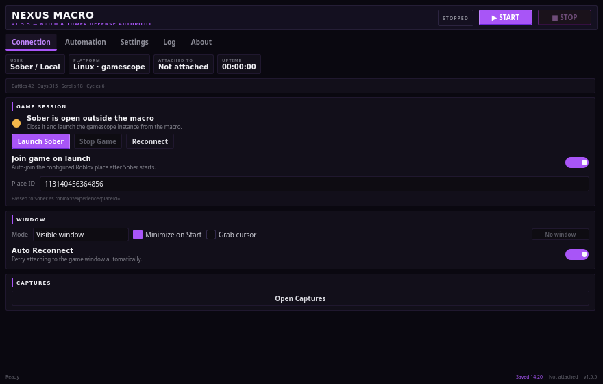
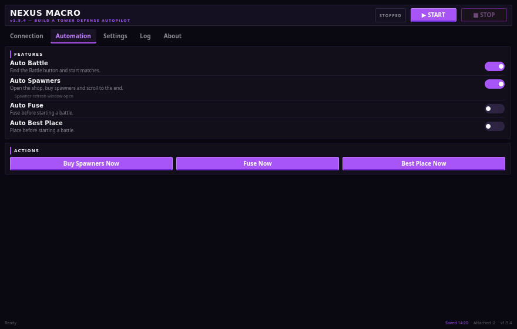
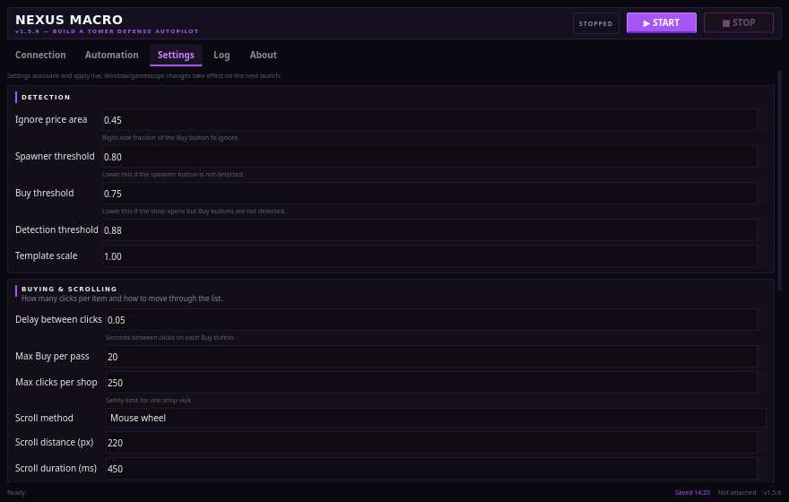
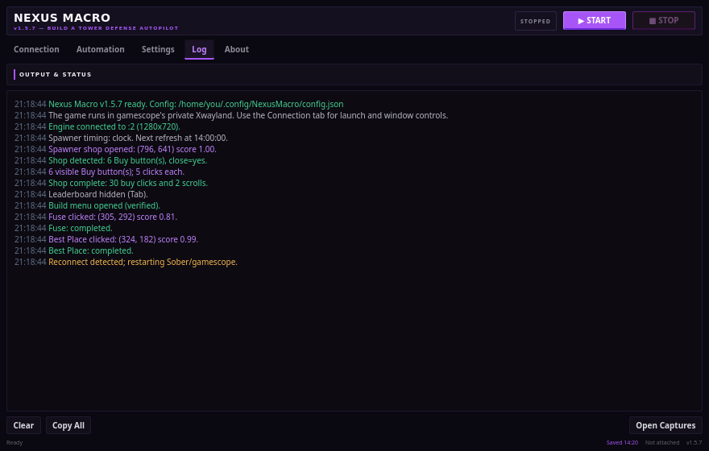
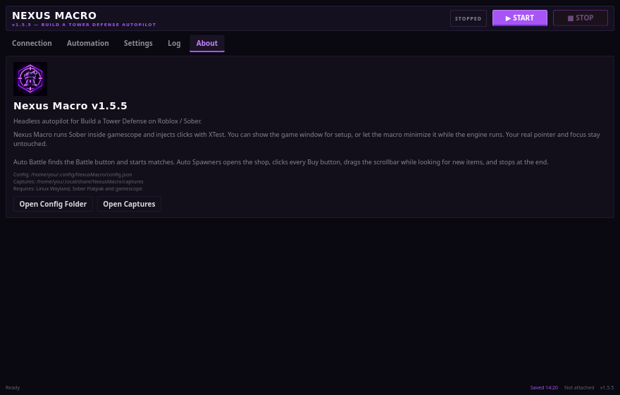

# Nexus Macro

**Build a Tower Defense autopilot for Linux, Sober and gamescope.**

[](https://github.com/Irregulaar/NexusMacro/releases/latest)
[](https://github.com/Irregulaar/NexusMacro)
[](https://github.com/Irregulaar/NexusMacro)
[](LICENSE)

Nexus Macro runs **Sober** (Roblox) inside **gamescope**, joins *Build a Tower
Defense* automatically, and drives the game through gamescope's private
Xwayland server with `XGetImage` + `XTest`. Your real pointer, keyboard and
focus are never touched. The game can stay visible for setup and minimize
itself while the macro runs.

> **Disclaimer:** automating a game may violate its Terms of Service. Use it at
> your own risk, preferably on an account you can afford to lose. Nexus Macro is
> not affiliated with Roblox, Risky Games, Sober or gamescope.

---

## Screenshots

| Connection | Automation |
| :--: | :--: |
|  |  |
| **Settings** | **Log** |
|  |  |

| About |
| :--: |
|  |

The interface is a fixed **880×560** compact window with a dark purple theme.

---

## Features

| Feature | What it does |
| --- | --- |
| **Auto Battle** | Clicks Battle / Continue when available, discards saved battles, and respects a cooldown. |
| **Auto Spawners** | At every 5-minute clock window (or by interval/continuous polling), opens the spawner shop, buys every visible item, scrolls, and closes it. |
| **Auto Fuse** | Before Battle: opens Build, clicks **Fuse All** twice, waits for the fusion, and closes Build. |
| **Auto Best Place** | Before Battle: uses the same Build menu as Fuse and clicks **Place Best** twice. If both are enabled, one menu handles both actions. |
| **Buy Spawners Now** | Runs a full spawner purchase on demand, even while the macro is stopped. |
| **Fuse Now / Best Place Now** | Manual actions; if a battle is running they Forfeit + Confirm first. |
| **Auto Join** | Passes `roblox://experience?placeId=...` to Sober and clicks Play on the loading screen. |
| **Auto Reconnect** | Relaunches Sober/gamescope if the game window disappears, and restarts the engine. |
| **Reconnect screen** | Detects `reconnectbutton.png`, **never clicks it**, closes Sober/gamescope and relaunches from scratch; retries later if the connection fails. |
| **Portable config** | In a project/dev install, settings live in `<project>/config/`; release installs use `~/.config/NexusMacro/`. |
| **Debug captures** | Failed detections save a PNG + JSON sidecar in `~/.local/share/NexusMacro/captures/`. |

---

## Requirements

- Linux with **Wayland** (KDE Plasma, GNOME, etc.).
- **Sober** as a Flatpak: `org.vinegarhq.Sober`.
- **gamescope** (system package, or the optional bundled copy in `vendor/gamescope` for development).
- **Release binary:** nothing else (Python, Qt, OpenCV are bundled).
- **From source:** Python 3.10+, `python3-venv`, pip.

Arch Linux:

```bash
sudo pacman -S --needed gamescope flatpak python python-pip
flatpak install flathub org.vinegarhq.Sober
```

The macro runs the game at **1280×720** inside gamescope, so your desktop
resolution does not matter. Templates are calibrated for that internal size.

---

## Install (release)

Download the latest **release tarball** from
[Releases](https://github.com/Irregulaar/NexusMacro/releases/latest):

```text
NexusMacro-<version>-linux-x86_64.tar.gz
```

Then:

```bash
tar -xzf NexusMacro-<version>-linux-x86_64.tar.gz
cd NexusMacro-<version>-linux-x86_64
./install.sh
```

The installer puts everything under `~/.local` (no sudo):

- `~/.local/bin/NexusMacro`
- `~/.local/share/applications/NexusMacro.desktop`
- icons in `~/.local/share/icons/hicolor/.../apps/nexusmacro.png`

Open **Nexus Macro** from the application menu. If your desktop does not show
the new icon immediately, log out and back in once (KDE caches app icons).

### Install with an AI assistant

Copy this prompt into an AI agent that has terminal access (Claude Code,
ChatGPT with a terminal, Cursor, etc.):

```text
Install Nexus Macro on this Linux PC from:
https://github.com/Irregulaar/NexusMacro

1. Check that this is Linux x86_64 and a Wayland session. If not, stop and explain.
2. Ask me before any sudo command. Detect my distro and install gamescope + flatpak
   (Arch: pacman, Fedora: dnf, Debian/Ubuntu: apt). Ensure the Flathub remote and
   install org.vinegarhq.Sober. If gamescope is unavailable, stop and tell me.
3. Download the latest release tarball and its .sha256 from GitHub Releases into
   /tmp. Verify the checksum with sha256sum -c.
4. Extract it and run ./install.sh (no sudo). Make sure ~/.local/bin is in PATH and
   refresh the desktop/icon caches. Do not build from source.
5. Run `NexusMacro --version` and tell me how to launch it from the menu.
6. Do not launch the game or ask for my Roblox credentials. If a command fails,
   show the exact error and stop instead of guessing.
```

### Uninstall

```bash
rm -f ~/.local/bin/NexusMacro
rm -f ~/.local/share/applications/NexusMacro.desktop
rm -rf ~/.local/share/icons/hicolor/*/apps/nexusmacro.png
# optional: remove settings and captures
rm -rf ~/.config/NexusMacro ~/.local/share/NexusMacro
```

---

## First run

1. Open Nexus Macro.
2. In **Connection**, press **Launch Sober**.
3. Complete the Roblox login/character setup in the game window.
4. Confirm the **Place ID** (default is *Build a Tower Defense*:
   `113140456364856`) and keep **Join game on launch** enabled.
5. Go to **Automation**, enable the features you want.
6. Press **Start**.
   - **Minimize on Start** hides the gamescope window automatically.
   - **Stop** stops the engine and cancels Auto Reconnect for that session.

The footer shows `Saved HH:MM` every time the config is written.

---

## Tabs

| Tab | Contents |
| --- | --- |
| **Connection** | Sober/gamescope status, Launch / Stop Game / Reconnect, Place ID, window mode, minimize controls, Auto Reconnect, captures folder. |
| **Automation** | Feature toggles, session stats, the three action buttons, and the next spawner countdown. |
| **Settings** | Detection thresholds, buying/scrolling limits, spawner schedule, gamescope/path fields. |
| **Log** | Full chronological log with captures and error messages. |
| **About** | Version, config/captures paths, shortcut buttons. |

---

## How it works

```text
KDE/Wayland desktop
        │   Nexus Macro never moves your real pointer
        ▼
┌──────────────────────────────────────┐
│ gamescope (1280×720)                 │
│  ┌────────────────────────────────┐  │
│  │ Private Xwayland (:2)          │  │
│  │  Sober / Roblox                │  │
│  │  Build a Tower Defense         │  │
│  └────────────────────────────────┘  │
└──────────────────────────────────────┘
        ▲
        │ XGetImage + XTest
        │
   Nexus Macro
```

- gamescope creates a private Xwayland at a fixed internal resolution.
- Nexus Macro captures that window with `XGetImage`.
- Clicks, scrolls and keys are injected with `XTest` inside the private server.
- The engine runs in a worker thread; the Qt window only shows state and edits
  the config. Stop is checked between every action.

---

## Automation details

### Auto Battle

Every `battle_poll` seconds it looks for Battle / Continue / “Yes, continue”
and clicks the match. If the saved-battle modal appears, it clicks **Discard**
and restarts the pre-battle flow. It never clicks Battle while a shop or modal
is open. A click is verified for up to 2.5 seconds (Forfeit visible or the
Battle button gone) before it is considered a failure.

### Auto Spawners

Spawner timing uses the PC clock by default (`hh:mm` multiples of 5), with
optional interval and continuous modes. Values live in `config.json`
(`spawner_timing`, `spawner_interval_minutes`, etc.).

1. Finds the compact spawner first, then the big one, then the full button with
   timer, at scales 0.65–1.30.
2. Closes a leftover shop before clicking the spawner. It **never buys** without
   the spawner click.
3. Opens the shop, buys every green Buy button (5 clicks each), scrolls, and
   repeats. The close button may flicker after buying; the macro waits for it
   instead of aborting the scroll.
4. Stops after two empty scrolls or `max_scrolls`, then closes the shop with
   the red X.
5. If the spawner click does not open a shop, it backs off for 15 seconds.

### Auto Fuse / Auto Best Place

Automatic flow, only outside a battle:

```text
Build → Fuse All ×2 → (wait) → Place Best ×2 → Stop
```

- If only Fuse is enabled, only Fuse runs.
- If only Best Place is enabled, only Place Best runs.
- If both are enabled, **one Build menu** handles both; the menu is closed once.
- If a battle is running, **Fuse Now / Best Place Now** Forfeit + Confirm first,
  wait for Build and then run.
- Manual Fuse/Best Place while the engine is running is queued on the same
  engine, so two engines never fight over the Build menu.

### Reconnect screen

When Roblox shows the reconnect button, clicking it can leave the client stuck.
Nexus Macro instead:

1. Detects `reconnectbutton.png`.
2. Stops the engine.
3. Closes Sober/gamescope (owned process, or `flatpak kill` for an external one).
4. Relaunches gamescope + Sober.
5. If the connection is still down, waits and retries later.

### Auto Join and Tab

Sober accepts a deep link:

```bash
flatpak run org.vinegarhq.Sober "roblox://experience?placeId=113140456364856"
```

Nexus Macro clicks **Play** on the loading screen. Tab is sent **only when
`tabimage.png` is visible** (the leaderboard header); if the image is not on
screen, Tab is not sent. It is armed again for a new match or after Auto
Reconnect restarts the engine.

---

## Configuration and paths

### Release install

```text
~/.config/NexusMacro/config.json
~/.config/NexusMacro/config.json.bak
~/.config/NexusMacro/config.invalid-*.json
```

### Project / development install

When running from the project folder (or with the `NexusMacro.home` marker
written by `install.sh`), the config is portable:

```text
<project>/config/config.json
<project>/config/config.json.bak
<project>/config/templates/      # optional user overrides
```

Check the active path at any time:

```bash
NexusMacro --config-path
```

The config is written atomically. The previous version is kept as
`config.json.bak`; a corrupt JSON is copied to `config.invalid-<date>.json`
before anything else happens. Settings save automatically and apply live:
feature toggles and buying/detection options can change while the engine runs.
Window/gamescope changes take effect on the next launch.

Only one Nexus Macro instance can run at a time (a lock prevents two windows
from overwriting each other's config).

---

## Templates and resolution

All game images live in `templates/`:

```text
battle1.png        battle2.png       yescontinue.png
spawners1.png      spawners2.png     spawnerbutton3.png
build1.png         fuseallbutton.png placebestbutton.png
stopbutton.png     forfeitbutton.png confirmbutton.png
discardbutton.png  playbutton.png    tabimage.png
reconnectbutton.png
buybutton.png      scrollspawner.png closebutton.png
```

They are calibrated for a **1280×720** game frame. The release bundles them;
players do not add images. The multi-scale search tolerates roughly
0.65×–1.30× UI scale changes.

Changing the internal resolution changes the game's UI layout; rebuild the
crops at that size if you do. The engine logs a warning if the attached window
is not 1280×720.

Optional overrides for development go in `<project>/config/templates/` with the
same filename. Normal users never need this.

---

## Troubleshooting

Always start with the **Log** tab. Failed detections save a PNG and a `.json`
sidecar in `~/.local/share/NexusMacro/captures/` (use **Open Captures**).

### Spawners are not bought

1. Run **Buy Spawners Now** and read the log.
2. It reports the best spawner candidate and scale, or saves
   `spawner_not_found_*.png`.
3. Lower **Spawner threshold** (try 0.72–0.78).
4. Check the timing mode and that the game is at 1280×720.

### The shop opens but does not scroll

Keep **Mouse wheel**. If the game ignores wheel input, switch to **Drag
scrollbar**. The list is allowed to settle before clicks.

### The game window is not attached

Use **Reconnect** in Connection, or relaunch Sober. Auto Reconnect handles this
automatically while the macro is running. If Sober was opened outside Nexus
Macro, close it and use **Launch Sober** so the macro owns the gamescope
instance.

### Stop does not close Sober

**Stop** stops the automation, not the game. Use **Stop Game** to close Sober,
or close the window yourself.

### Reconnect loop

If your internet is down, the game will show the reconnect screen again. Nexus
Macro closes and relaunches it, then waits before another full restart. Fix the
connection and it will rejoin on the next attempt.

### The app icon is stale after updating

Close all Nexus Macro windows and reopen. KDE caches app icons; if it still
shows the old one, log out and back in once.

---

## Build from source

```bash
git clone https://github.com/Irregulaar/NexusMacro.git
cd NexusMacro
python3 -m venv .venv
./.venv/bin/pip install -r requirements.txt

# run from source
./run_dev.sh

# build the standalone binary
./build_linux.sh

# install the built binary + menu entry
./install.sh
```

`build_linux.sh` bundles `vendor/gamescope` when present. For a system
gamescope build (recommended for releases):

```bash
BUILD_WITH_VENDOR=0 ./build_linux.sh
```

Tests and self-checks:

```bash
./.venv/bin/python -m unittest discover -s tests -q
./.venv/bin/python app.py --selftest
QT_QPA_PLATFORM=offscreen ./.venv/bin/python app.py --ui-selftest
QT_QPA_PLATFORM=offscreen ./.venv/bin/python app.py --ui-config-test
```

Current status: **60 tests OK**.

---

## Creating a release

1. Update `APP_VERSION` in `nexusmacro/paths.py`, `CHANGELOG.md` and the README
   version badge.
2. Run the tests above.
3. Create and push a tag:

```bash
git tag v1.5.4
git push origin v1.5.4
```

The GitHub Actions workflow `.github/workflows/release.yml` builds the binary
without the vendored gamescope, packages a tarball and attaches it (plus its
SHA-256) to the GitHub Release.

To build the same tarball locally:

```bash
./scripts/package_release.sh
# release/NexusMacro-1.5.4-linux-x86_64.tar.gz
# release/NexusMacro-1.5.4-linux-x86_64.tar.gz.sha256
```

The release tarball contains the binary, `install.sh`, the desktop entry, the
icons, README, LICENSE and CHANGELOG. The end-user install uses
`~/.config/NexusMacro/` (no project folder required).

---

## Project structure

```text
app.py                     entry point + CLI flags
nexusmacro/
  engine.py                tick orchestrator
  automation/              runtime, detection, navigation, shop, build, spawner
  controller.py            Qt bridge / worker thread
  ui.py, ui_pages.py       main window and page layouts
  vision.py, shopvision.py template and color detection
  backend.py               X11 capture + XTest input
  launcher.py              gamescope / Sober launcher
  config.py, paths.py      persistent settings and portable paths
templates/                 bundled game UI crops
assets/                    icon + Qt stylesheet
docs/                      architecture, refactor notes, screenshots
tests/                     60 unit/integration tests
```

More detail:

- [`docs/ARCHITECTURE.md`](docs/ARCHITECTURE.md) — every module, class, config
  field, template and data path.
- [`docs/REFACTOR_PLAN.md`](docs/REFACTOR_PLAN.md) — audit, refactor phases,
  measured performance and acceptance criteria.
- [`docs/WINDOWS_PORT.md`](docs/WINDOWS_PORT.md) — what a Windows foreground
  port needs and where the risks are.
- [`docs/RUST_ASSESSMENT.md`](docs/RUST_ASSESSMENT.md) — Rust vs Python,
  cross-platform plan and the real costs.
- [`CHANGELOG.md`](CHANGELOG.md) — release history.

---

## License

Code is released under the [MIT License](LICENSE).

The files in `templates/` are screenshots/crops of the game's user interface.
Their artwork and trademarks belong to their respective owners; they are
included only so the automation can recognise the game UI. If you redistribute
this project, keep that in mind.

Nexus Macro is a personal automation project. It is not affiliated with or
endorsed by Roblox, Risky Games, Sober or gamescope.
